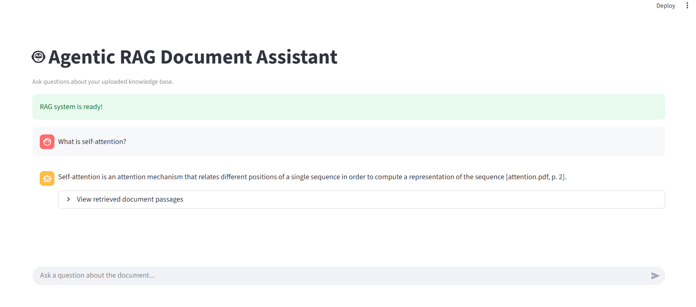
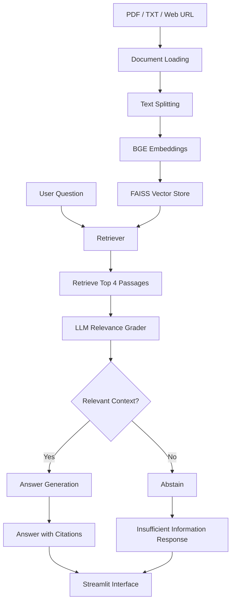

# Agentic RAG Document Assistant

A local Retrieval-Augmented Generation (RAG) application built with **LangGraph, LangChain, FAISS, Hugging Face embeddings, and Ollama**. It retrieves relevant document passages, evaluates their relevance, and generates answers with source citations.


## Overview

This project implements a locally running Agentic RAG pipeline that answers questions using information retrieved from supplied documents.

Instead of directly generating an answer, the application follows a workflow:

1. Load and split source documents into chunks.
2. Generate vector embeddings for the chunks.
3. Retrieve the most relevant passages using FAISS.
4. Grade retrieved passages for relevance using an LLM.
5. Generate a grounded answer with document citations when relevant context is available.
6. Abstain when the retrieved documents do not contain sufficient information.

The application includes a Streamlit interface and LangSmith tracing and evaluation.
## Application Screenshot



## Architecture



## Technology Stack

| Component | Technology |
|---|---|
| Programming language | Python |
| LLM orchestration | LangChain |
| Agent workflow | LangGraph |
| Local language model | Ollama – Llama 3.2 |
| Embedding model | BAAI/bge-small-en-v1.5 |
| Vector database | FAISS |
| Document processing | PyPDFLoader, WebBaseLoader, TextLoader |
| Text splitting | RecursiveCharacterTextSplitter |
| User interface | Streamlit |
| Tracing and evaluation | LangSmith |
| Environment and dependencies | uv |

## Key Features

- **Multiple document sources:** Load PDF files, text files, and web URLs.
- **Semantic retrieval:** Use BGE embeddings and FAISS similarity search.
- **Agentic workflow:** Orchestrate retrieval, relevance grading, and conditional response generation with LangGraph.
- **Relevance grading:** Evaluate retrieved passages before generating an answer.
- **Source citations:** Include document and page references in generated answers.
- **Abstention:** Return an insufficient-information response when relevant context is unavailable.
- **Local inference:** Run the language model through Ollama.
- **Observability:** Trace application execution with LangSmith.
- **Evaluation:** Evaluate answer correctness, faithfulness, retrieval relevance, and citation accuracy.

## Project Structure

```text
agentic-rag-document-assistant/
│
├── data/
│   ├── attention.pdf
│   └── url.txt
│
├── evaluation_results/
│
├── src/
│   ├── config/
│   │   └── config.py
│   ├── document_ingestion/
│   │   └── document_processor.py
│   ├── graph_builder/
│   │   └── graph_builder.py
│   ├── node/
│   │   ├── nodes.py
│   │   └── reactnode.py
│   ├── state/
│   │   └── rag_state.py
│   └── vectorstore/
│       └── vectorstore.py
│
├── main.py
├── streamlit_app.py
├── evaluate_langsmith.py
├── add_dataset_examples.py
├── evaluate_rag.py
├── test_rag.py
├── test_react.py
├── pyproject.toml
├── requirements.txt
├── uv.lock
└── README.md
```

## Getting Started

### Prerequisites

Install the following:

- Python 3.13
- [Git](https://git-scm.com/)
- [uv](https://docs.astral.sh/uv/)
- [Ollama](https://ollama.com/)

### 1. Clone the repository

```bash
git clone https://github.com/pskiran24/Agentic-Rag-Document-Assistant.git

cd Agentic-Rag-Document-Assistant
```

### 2. Install dependencies

```bash
uv sync
```

### 3. Download the Ollama model

Start Ollama and run:

```bash
ollama pull llama3.2
```

The application is configured to use `llama3.2:latest`.

### 4. Configure environment variables

Create a `.env` file in the project root.

For LangSmith tracing, configure:

```env
LANGSMITH_TRACING=true
LANGSMITH_API_KEY=your_langsmith_api_key
LANGSMITH_PROJECT=local-agentic-rag
```

LangSmith configuration is optional for running the core RAG application. Keep your API key private and never commit `.env` to GitHub.

### 5. Run the application

Launch the Streamlit interface:

```bash
uv run streamlit run streamlit_app.py
```

Alternatively, run the main application:

```bash
uv run python main.py
```

## Evaluation

The application was evaluated using a LangSmith dataset containing five question-and-reference-answer examples based on the research paper *Attention Is All You Need*.

The evaluation uses the local RAG application and Llama 3.2 as the evaluation judge.

### Initial Evaluation Results

| Metric | Average Score |
|---|---:|
| Citation accuracy | 0.84 |
| Answer correctness | 0.75 |
| Faithfulness | 0.60 |
| Retrieval relevance | 0.70 |

**Evaluation run details:**

- Dataset size: 5 questions
- Median latency (P50): 19.11 seconds
- LLM: Llama 3.2
- Embeddings: BAAI/bge-small-en-v1.5
- Vector store: FAISS

These are initial experimental results from a small evaluation dataset, not production performance guarantees. The results provide a baseline for further improvements in retrieval quality, answer grounding, citation handling, and latency.

## Observability with LangSmith

LangSmith tracing is used to inspect the execution of the RAG workflow, including:

- Document retrieval
- Relevance grading
- Conditional routing
- Answer generation
- Execution latency

The evaluation experiment records per-question scores for the selected evaluation metrics.

## Future Improvements

- Hybrid retrieval combining BM25 and dense vector search.
- Cross-encoder reranking.
- Larger evaluation dataset with 30–50 questions.
- Improved citation validation and answer grounding.
- Retrieval and generation latency optimization.
- Docker-based deployment.
- Public cloud deployment.

## Author

**Kiran P S**

M.Tech – Data Science

Interested in AI/ML Engineering, Generative AI, LLMs, and Retrieval-Augmented Generation.

- GitHub: [@pskiran24](https://github.com/pskiran24)
- Project: [Agentic RAG Document Assistant](https://github.com/pskiran24/Agentic-Rag-Document-Assistant)

---

*This is an independent portfolio project built using publicly available material. It does not contain proprietary GE Aerospace code or data.*
